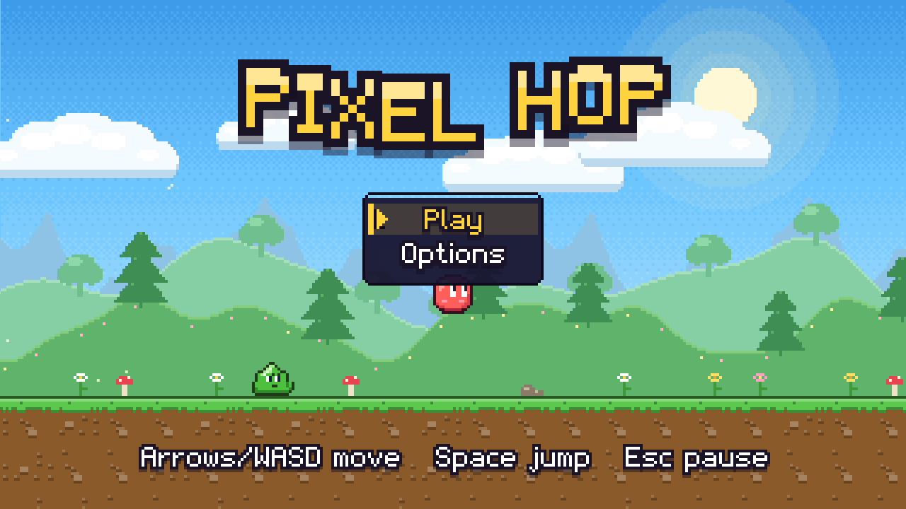
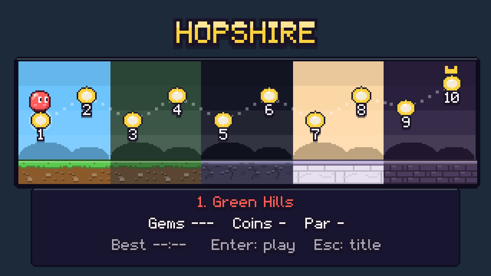
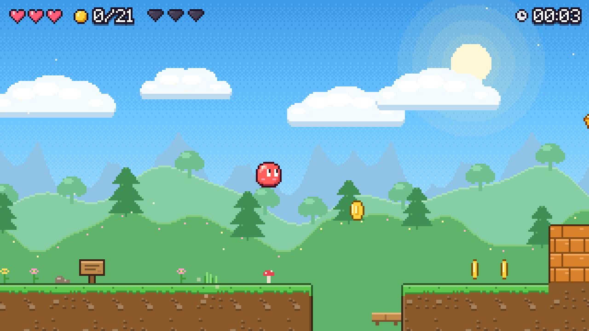
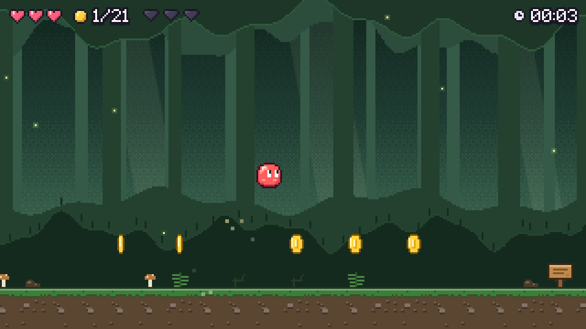
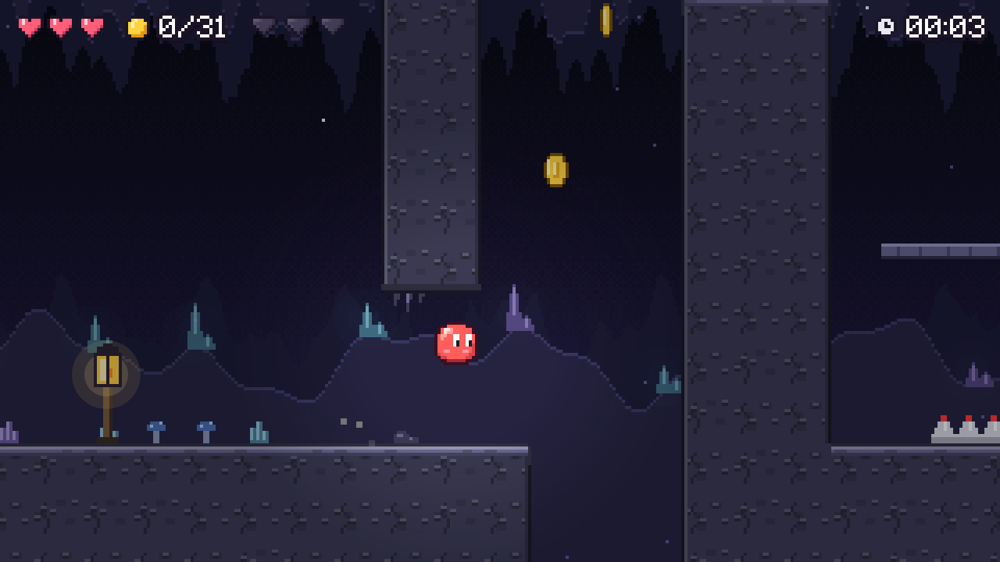
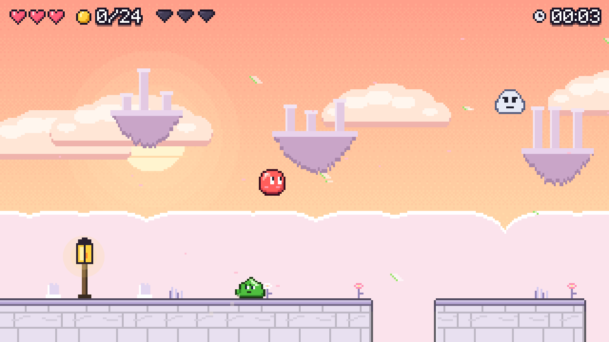
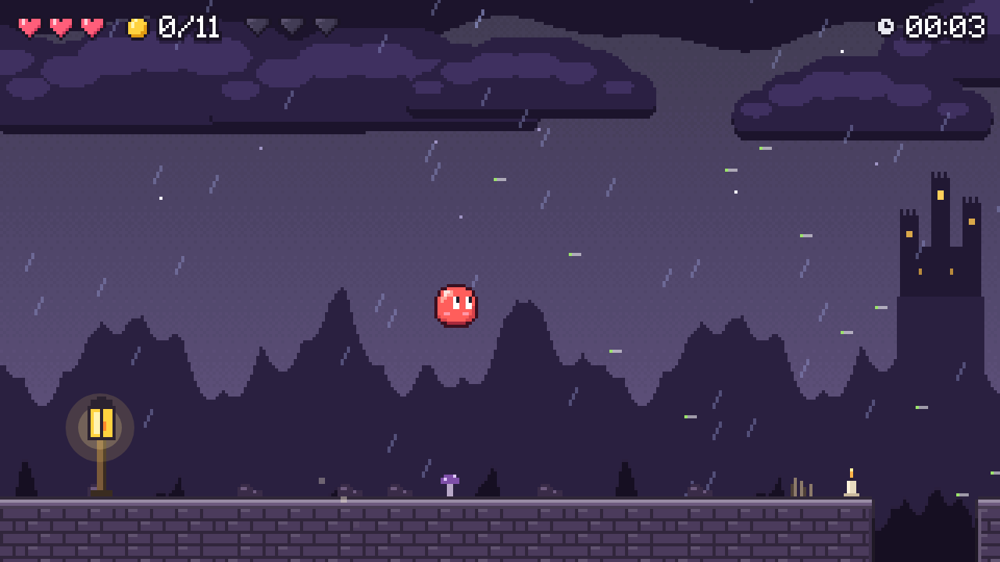
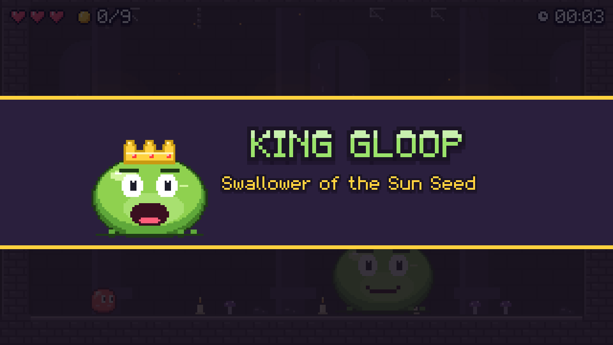
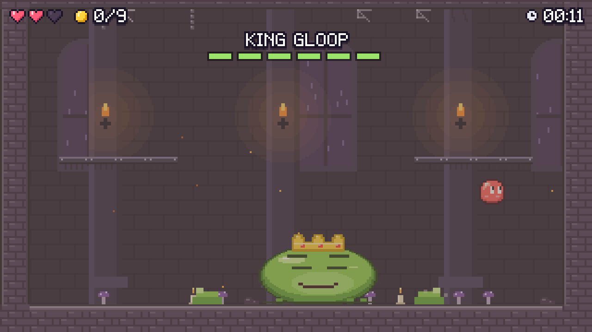

# Pixel Hop

A free pixel-art platformer you can play in your browser, on desktop or phone.

### ▶️ [Play it now](https://mahmoudalnkeeb.github.io/pixel-hop/)

No download, no sign-up, no ads.



## The story

King Gloop, a bloated slime king, swallowed the Sun Seed, and the meadow of Hopshire turned grey. You play as **Hop**, a small red blob with big eyes and a bigger jump. Cross five worlds, reach the King's throne, and win the Sun Seed back.

## What's in it

- **10 levels in 5 worlds:** Green Hills, Bramble Woods, Crystal Caves, Cloud Ruins and Storm Keep
- **One new idea per level:** springs, crumbling blocks, wall jumps, wind, cannons, switches and more
- **A three-phase boss fight** against King Gloop
- **27 hidden Sun Gems** behind fake walls, hard jumps and secret routes
- **Fast retries:** you respawn at the last checkpoint in under a second
- **Original chiptune music** and hand-made pixel art
- **Assist Mode** if a section is too hard: slower game speed, extra hearts or invincibility
- Touch controls on phones, and keys you can remap on desktop

## Screenshots

| | |
| --- | --- |
|  |  |
|  |  |
|  |  |
|  |  |

## Controls

| Action | Keyboard | Phone |
| --- | --- | --- |
| Move | ← → or A D | Thumbstick |
| Jump (hold to jump higher) | Space, ↑, W or Z | Jump button |
| Drop through a platform | ↓ + Jump | Down + Jump |
| Wall jump (from level 5) | Jump while sliding on a wall | Jump button |
| Pause | Esc or P | Pause icon |

Keys can be changed under **Options → Controls**.

## Built with

Plain JavaScript and Canvas 2D on [h3-engine](https://github.com/mahmoudalnkeeb/h3-engine), a small game engine I also wrote. There is no build step, and all the art and music are generated in code when the game starts. The full design is in [`design/pixel-hop-gdd.md`](design/pixel-hop-gdd.md).

Feedback and bug reports are welcome in [Issues](https://github.com/mahmoudalnkeeb/pixel-hop/issues).

---

## For developers

### Run locally

```sh
npm start            # static server on http://localhost:8080
npm test             # headless physics checks against GDD §3.2/§3.3
npm run check-levels # proves every flag and Sun Gem is reachable, using the real player physics
npm run release      # dist/ build with import and 6 MB budget checks
npm run deploy       # tests + level checker + release, then publishes dist/ to the gh-pages branch
```

Release status against the GDD §12 checklist: `docs/acceptance.md`.

Dev URLs: `?level=1`, `?level=2`, `?level=10` (boss), `?level=sandbox` (every ability in one level), `&debug` (overlay, toggle with `` ` ``; exposes `window.game` and unlocks every built level on the map).

Browser smoke tests (need Chrome and a server on :8765, e.g. `python3 -m http.server 8765`):

```sh
node test/run-smoke.mjs 1             # run right through level 1, pause, clear
node test/run-smoke.mjs 10 60 '' boss # scripted King Gloop phase 1
```

Playtesting (§11): with `&debug`, press **F9** to download telemetry (deaths and time per checkpoint segment), then `node tools/telemetry-report.mjs <files>` flags segments with median deaths > 8 or time > 2× par.

Levels 2–10 are generated: edit `tools/build_levels.py`, run `python3 tools/build_levels.py`, then `npm run check-levels`.

### Layout

| Path | What |
| --- | --- |
| `src/config.js` | Every tunable constant and key binding. Tune only here. |
| `src/world/Level.js` | ASCII map loader, tile collision, one-way + moving-platform landings |
| `src/entities/Player.js` | Hop: run, variable jump, coyote, buffer, stomp, drop-through, wall slide/jump, hearts |
| `src/entities/Enemy.js` | Slime, Hopper, Gloop Knight, Thornback, Bat, Dropper, Puffer, spores |
| `src/entities/mechanics.js` | Crumble blocks, switches, cannons and acorns, crystals, wind, thornwater |
| `src/entities/KingGloop.js` | King Gloop's three phases (§6), shockwaves, goo, rocks, the Sun Seed |
| `src/scenes/` | title, select (world map), play, pause, options, clear, boss intro, assist offer, ending |
| `src/art/` | Pixel art painted into sprite sheets at startup (characters, per-world tiles, boss) |
| `src/audio/` | Music/SFX/UI buses with ducking (`Mixer`), chiptune sequencer (`Jukebox`), score (`songs.js`) |
| `levels/*.json` | Levels in the GDD §4.1 format; add new ids to `BUILT_LEVELS` in config |
| `screenshots/` | Images used in this README |
